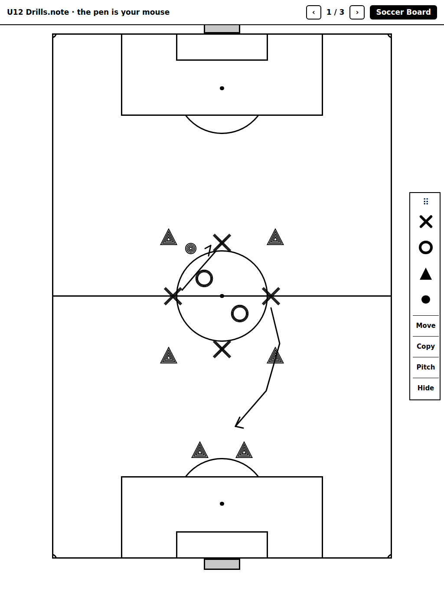

# SNSoccer: Soccer Board for Supernote

A coach's whiteboard plugin for Supernote. Draw runs and passes on the note
page with your pen, and drag players, cones and balls onto it from a palette
that floats over the note while you write.

**Pen draws, finger moves.**



## How it works

- **Pitch pages.** Soccer Board adds a page after the current one with a
  regulation pitch as its background, goals at the top and bottom. You write
  on it like any page. Pieces can go on any page, not just pitch pages.
- **The floating palette** is a narrow strip docked to the side of the screen.
  It stays up while you write:

  | Control | What it does |
  |---|---|
  | ⠿ | Drag the grip to move the palette. It docks to the nearer side. |
  | **X O ▲ ●** | Drag one onto the page with your finger to place it: Team X player, Team O player, cone, ball. |
  | Move | A layer for dragging pieces already on the page. Drop one on the palette to remove it. Done returns to writing. |
  | Copy | Copies this page, background, drawings and pieces, to a new page after it, all still editable. Good for drill progressions. |
  | Pitch | Adds a blank pitch page after this one. |
  | Hide | Puts the palette away until you show it again. |

- **Pieces are real note shapes**, lines, circles and polygons drawn by the
  Note app. They're told apart by shape, not colour, for the greyscale screen,
  and they stay on the page after the plugin closes. On pitch pages they go on
  their own "Pieces" layer; you write on the main layer, so the native lasso
  and eraser there leave them alone.
- **Why a finger for the palette?** On a Supernote the pen reaches the note by
  a hardware path that no window can intercept, so a pen on the palette also
  writes on the page underneath. A finger never writes. A pen still works on
  the palette if you don't mind the mark, and the plugin says so the first
  time.
- **The toolbar panel** is for setup. Open **Soccer Board** from the Note
  toolbar to allow the palette (Android's "Display over other apps", granted
  to the plugin host), show or hide it, and add a pitch page. The first time
  it opens, it draws the pitch background.

## How it's built

| Path | What it is |
|---|---|
| `index.js` | Registers the panel, starts the palette controller, adds the NOTE toolbar button |
| `App.tsx` | The panel: palette setup, pitch preparation, instructions |
| `android/.../palette/` | The floating palette in Kotlin: the strip, the drag ghost and the move layer as system overlay windows (`SoccerPaletteModule`, registered in `MainApplication`) |
| `src/palette/controller.ts` | Turns palette events into page edits, one at a time |
| `src/page/pageOps.ts` | Place, move and remove pieces; copy a page; add a pitch page |
| `src/page/pieceShapes.ts` | Each piece as note geometry, and the `userData` tag that identifies it |
| `src/page/capture.ts`, `src/components/PitchSheet.tsx` | Drawing and saving the pitch background |

The page work follows what the Modulanner plugin established on devices:

- Every page edit runs with the panel **closed**, because SDK calls can
  deadlock while it's open. With the panel closed the host also suspends JS
  timers, so nothing waits on one.
- `saveCurrentNote()` runs before a page is inserted, or strokes still on
  screen are lost.
- `insertNotePage`'s `page` is the index the new page takes, and a PNG path
  works as its template.
- Only an explicit `success: false` is a failure. Older firmware answers
  `null` from calls that worked.
- Pieces are tagged with `userData`. Some firmware drops it, so every write is
  also recorded per page in AsyncStorage, and untagged shapes that match a
  recorded piece exactly count as that piece. The user's own drawing is never
  touched.

## Build

Requirements are those of the Supernote template: Node 18+, JDK 19+, Android
SDK 35, and React Native **0.79.2** (locked to the PluginHost runtime).

```bash
npm install
npm run build:plugin          # -> build/outputs/snsoccer.snplg
```

`build:plugin` runs Gradle's autolinking step and then the template's
`buildPlugin.sh`, or `buildPlugin.ps1` on Windows. The plugin carries native
code (the palette, AsyncStorage and ViewShot), which `buildPlugin` compiles into
`app.npk` and lists in `PluginConfig.json`'s `reactPackages`. It reads the
autolinked part of that list from Gradle output that doesn't exist on a clean
checkout, so running `buildPlugin` directly the first time produces a plugin
that fails on launch; running it a second time also fixes that.

Install on the device:

```bash
adb push build/outputs/snsoccer.snplg /storage/emulated/0/MyStyle/
# Then on the device: Settings → Apps → Plugins → Add Plugin
```

`PluginConfig.json` is committed with a fixed `pluginID`. Keep it unchanged
once the plugin has been shared, because the device identifies plugins by that
ID.

## Preview in a browser

`tools/ui-preview` is a copy of
[sn-plugin-ui-preview](https://github.com/firestormkirby/sn-plugin-ui-preview)
extended with a simulated note. It runs the real panel and the real palette
controller against an in-memory note: the mouse is the pen on the page, and a
web stand-in for the native palette (`tools/ui-preview/soccer/WebPalette.tsx`)
sends the same events the Kotlin one does.

```bash
npm run preview:install       # once
npm run preview               # http://localhost:5178
```

Scenarios: *Drawing a drill*, *First run*, *Palette allowed*, *Blank note* and
*In a PDF*. The browser console logs every SDK call. The preview can't
reproduce the device's pen hardware, SDK threading or real file writes.

## Develop

```bash
npm test           # piece shapes, page operations (with and without userData), controller, panel
npm run typecheck
npm run lint
```

The Kotlin was compiled against the Android framework and React Native
0.79.2's signatures, but it hasn't run on a device yet.

## To check on the first device install

- **The palette appears** after allowing "Display over other apps" for the
  plugin host, and stays over the note after the panel closes. Check whether
  it lingers over other apps after leaving the note; if it does, Hide puts it
  away.
- **Pieces look right.** Geometry `penWidth` units aren't documented. The
  pieces use 300, and their solid shapes are nested outlines 3px apart. If
  they come out hairline or blobby, tune `PIECE_PEN.width` in
  `src/page/pieceShapes.ts`.
- **Moving and removing find the pieces.** Check the log for
  `insertPageElements` / `batchUpdatePageElements` results, and whether
  `userData` survives (if not, the AsyncStorage fallback takes over).
- **The Pieces layer** on new pitch pages (`insertLayer`), and that pieces
  land on it.
- **Copy page** carries drawings over (`insertElements` with elements read
  from the source page).
- **Rotation.** Placing and moving are limited to the upright screen for now,
  and the palette says so when turned. Turned pages need the screen-to-page
  mapping measured on a device.
